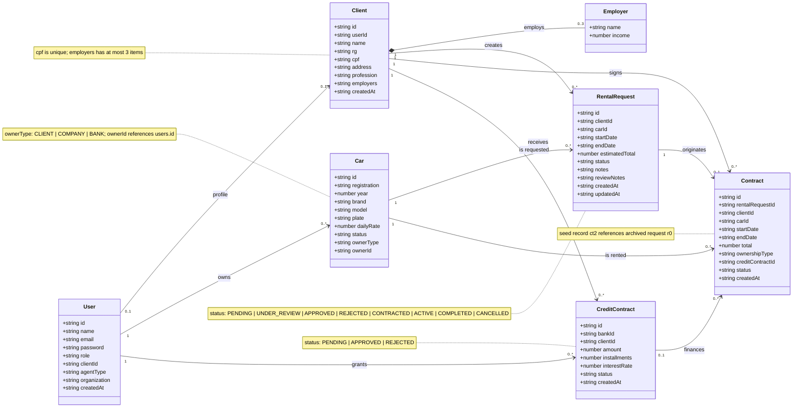

# Class Diagram

Domain model implemented by the lab. The classes represent the JSON records
persisted by JSON Server; behavior (validation, pricing, permissions, and state
transitions) lives in the pure modules under `public/js/domain/` and is not
modeled as entity methods.

## Diagram

## Fields and rules

| Class | Field | Type / rule |
| --- | --- | --- |
| `User` | `role` | `client` or `agent`; other values are rejected at login |
| `User` | `agentType` | `COMPANY`, `BANK`, or `null` for clients |
| `User` | `clientId` | present only for `client` users; links to the `Client` record |
| `User` | `password` | demo plain text; never copied into the session |
| `Client` | `cpf` | valid CPF, unique per client, formatted in the UI |
| `Client` | `employers` | array of `Employer` with **0 to 3** entries |
| `Employer` | `income` | BRL amount, greater than or equal to zero |
| `Car` | `status` | `AVAILABLE`, `RENTED`, or `MAINTENANCE` |
| `Car` | `ownerType` | `CLIENT`, `COMPANY`, or `BANK` |
| `Car` | `ownerId` | `users.id` of the recorded owner |
| `RentalRequest` | `estimatedTotal` | computed by `estimateTotal(dailyRate, startDate, endDate)` |
| `RentalRequest` | `status` | one of the eight request states |
| `Contract` | `ownershipType` | `CLIENT`, `COMPANY`, or `BANK` |
| `Contract` | `creditContractId` | optional; when present, points to an approved credit contract |
| `Contract` | `status` | `ACTIVE`, `COMPLETED`, or `CANCELLED` |
| `CreditContract` | `bankId` | `users.id` of a `BANK` agent |
| `CreditContract` | `amount` | greater than zero |
| `CreditContract` | `installments` | integer from 1 to 60 |
| `CreditContract` | `interestRate` | percentage greater than or equal to zero |

## Multiplicities

- **User 0..1 — 0..1 Client:** public registration creates both records and
  fills `User.clientId` and `Client.userId`. Clients created by an agent may
  have no user account, so the association is optional in both directions.
- **Client 1 — 0..3 Employer:** composition. Employers do not exist outside the
  client, and the limit is enforced by `MAX_EMPLOYERS`.
- **User 1 — 0..* Car:** the owner is stored in `Car.ownerId`. A rental company
  agent can own several cars; a car has one owner.
- **Client 1 — 0..* RentalRequest / Car 1 — 0..* RentalRequest:** a client makes
  many requests and a car can appear in many requests, but only one active
  contract can occupy a given period.
- **RentalRequest 1 — 0..1 Contract:** a contract is executed once from an
  `APPROVED` request. The historical `ct2` record points to a request that no
  longer exists (`r0`), rendered as archived.
- **Client 1 — 0..* Contract / Car 1 — 0..* Contract:** each contract copies
  `clientId` and `carId` to preserve history even if the original record
  changes.
- **User 1 — 0..* CreditContract:** `bankId` identifies the bank agent that
  granted the credit.
- **CreditContract 0..1 — 0..* Contract:** a rental contract may have no credit
  link (`ct2`) or point to an approved credit (`ct1` → `cc3`).

## Implicit enumerations

| Enumeration | Values | Module |
| --- | --- | --- |
| Request status | `PENDING`, `UNDER_REVIEW`, `APPROVED`, `REJECTED`, `CONTRACTED`, `ACTIVE`, `COMPLETED`, `CANCELLED` | `domain/request-state.js` |
| Car status | `AVAILABLE`, `RENTED`, `MAINTENANCE` | `domain/validation.js` |
| Ownership type | `CLIENT`, `COMPANY`, `BANK` | `domain/validation.js` |
| Contract status | `ACTIVE`, `COMPLETED`, `CANCELLED` | `domain/validation.js` |
| Credit status | `PENDING`, `APPROVED`, `REJECTED` | `domain/validation.js` |
