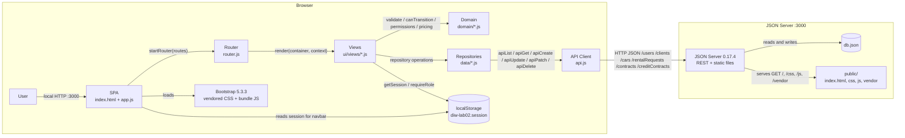

# Component Diagram

The diagram shows the running components and their interfaces. The application
is a SPA served as static files by JSON Server itself; there is no separate
application server.

## Diagram

## Interfaces

| From | To | Interface | Contract |
| --- | --- | --- | --- |
| User | SPA | Hash routes | `#/`, `#/login`, `#/requests/:id`, etc.; no server rewrite is required. |
| SPA | Router | `startRouter(routes)` | Receives the route table and listens for `hashchange`; renders into `#app`. |
| Router | Views | `render(container, context)` | `context = { params, query, session }`; every view exports this function. |
| Views | Domain | Pure functions | `validateClient`, `validateCar`, `validateRentalRequest`, `validateContract`, `validateCreditContract`, `datesOverlap`, `canTransition`, `assertTransition`, `allowedTransitions`, `canManage*`, `canEditRequest`, `canCancelRequest`, `canExecuteContract`, `estimateTotal`, `rentalDays`. |
| Views | Repositories | Collection functions | `list*`, `get*`, `create*`, `update*`, `delete*`, plus `executeContract`, `startRental`, `completeRental`, and `cancelRental`. |
| Repositories | API Client | `apiList`, `apiGet`, `apiCreate`, `apiUpdate`, `apiPatch`, `apiDelete` | Return `Promise<Object|Array|void>` and throw `ApiError` on non-2xx responses. |
| API Client | JSON Server | REST/JSON | `GET/POST/PUT/PATCH/DELETE` on `/users`, `/clients`, `/cars`, `/rentalRequests`, `/contracts`, and `/creditContracts`. |
| JSON Server | `db.json` | JSON file | Runtime source of truth; created from `db.seed.json` and ignored by Git. |
| JSON Server | `public/` | Static files | Serves the SPA, CSS, ES modules, and vendored Bootstrap. |
| SPA / Views | `localStorage` | Key `diw-lab02.session` | JSON with `id`, `name`, `email`, `role`, `agentType`, and `clientId`; never contains a password. |
| SPA | Bootstrap | CSS and `bootstrap.Toast` | Visual components and toasts; the bundle is loaded locally. |

## Flows that cross components

### Login

1. `login.js` calls `authenticate(email, password)` in `data/users.js`.
2. The repository queries `GET /users` through `api.js`.
3. On success, `setSession(user)` stores the password-free snapshot in
   `localStorage` and the router navigates to `#/`.
4. The navbar re-renders with links for the authenticated role.

### Contract execution

1. `contract-form.js` validates the request and the selected ownership type.
2. `executeContract` in `data/contracts.js` validates the domain transition
   `APPROVED` → `CONTRACTED`.
3. The repository performs `POST /contracts`, `PATCH /rentalRequests/:id`, and
   `PATCH /cars/:id` in sequence.
4. The screen navigates to `#/contracts/:id` and shows the active contract.

This flow is **not atomic**: if one of the three calls fails after earlier
writes succeed, JSON Server does not roll them back. The README documents this
limitation.
