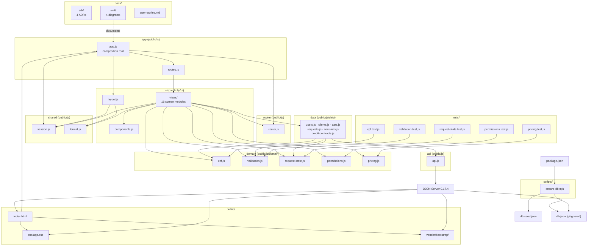

# Package Diagram (Logical View)

The diagram mirrors the real folder and module structure. Arrows represent
import or runtime dependencies, not user flow.

## Diagram

## Packages and responsibilities

| Package / folder | Files | Responsibility |
| --- | --- | --- |
| `app` | `app.js`, `routes.js` | SPA composition: mounts the layout, starts the router, and declares the route table with role guards. |
| `router` | `router.js` | Parses the hash, matches `:params`, applies guards, and calls `render(container, context)`. |
| `ui` | `ui/layout.js`, `ui/components.js`, `ui/views/*.js` | Presentation: navbar, toasts, forms, lists, and detail screens. No workflow rules are computed inline. |
| `domain` | `cpf.js`, `validation.js`, `request-state.js`, `permissions.js`, `pricing.js` | Pure rules: CPF, entity validation, state machine, permissions/ownership, and pricing. No DOM, `fetch`, or `localStorage`. |
| `data` | `users.js`, `clients.js`, `cars.js`, `requests.js`, `contracts.js`, `credit-contracts.js` | Repositories: collection operations, reference checks, and multi-collection workflows. |
| `api` | `api.js` | Thin HTTP client over `fetch`; centralizes URLs, `ApiError`, and body parsing. |
| `shared` | `session.js`, `format.js` | Password-free session in `localStorage` and PT-BR formatting/HTML escaping. |
| `public` | `index.html`, `css/app.css`, `vendor/bootstrap/` | HTML shell, small overrides, and vendored Bootstrap 5.3.3. |
| `scripts` | `ensure-db.mjs` | Creates or restores `db.json` from `db.seed.json`. |
| `tests` | five `*.test.js` files | Unit tests with `node:test` for the domain modules. |
| `docs` | `adr/`, `uml/`, `user-stories.md` | Architecture decisions, diagrams, and user stories. |

## Dependency rules

- `domain` imports nothing from `ui`, `data`, `api`, or `session`.
- `data` may import `api` and `domain`; it never imports `ui`.
- `ui` imports `domain`, `data`, `api`, `shared`, and `router`.
- `app` is the only composition root; no module imports `app.js`.
- `tests` import only `domain` (and the modules it uses).
