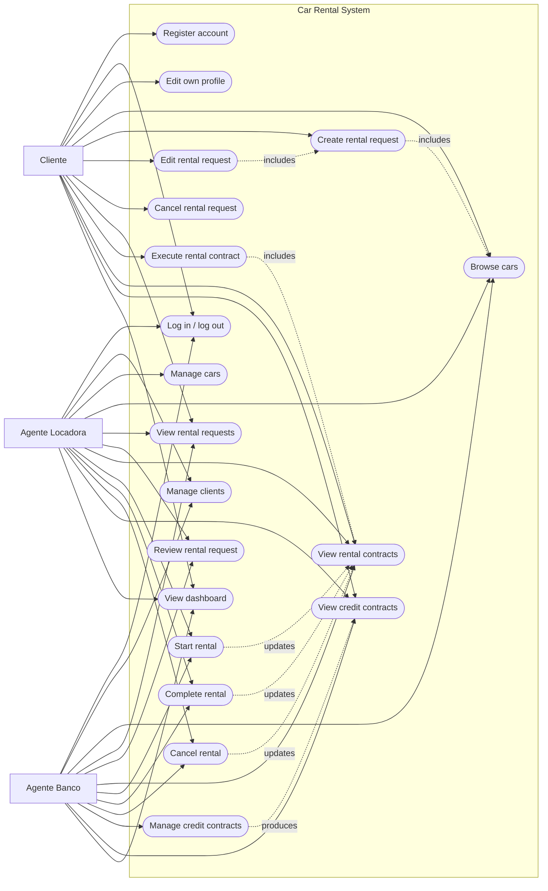

# Use Case Diagram

Car rental system — DIW Lab 02.

The diagram describes the behavior implemented in the application. The use
cases were derived from the views in `public/js/ui/views/` and the rules in
`public/js/domain/`, not from an idealized design.

## Actors

| Actor | Description | Source of truth |
| --- | --- | --- |
| **Cliente** | A person who rents vehicles, maintains their profile, creates and tracks requests, executes contracts, and views their own credit contracts. | `users.role = "client"` with `clientId` |
| **Agente Locadora** | A rental company employee. Manages clients and the fleet, reviews requests, and operates rental contracts. | `users.role = "agent"`, `agentType = "COMPANY"` |
| **Agente Banco** | A bank employee. Manages clients, reviews requests, maintains credit contracts, and tracks rental contracts. | `users.role = "agent"`, `agentType = "BANK"` |

> Implementation note: `canReviewRequests` allows **any** agent to review
> requests, and the contract actions use the same permission. Therefore, in the
> current build, a bank agent can also start, complete, and cancel rentals. The
> diagram reflects the code as implemented.

## Diagram

## Use case catalogue

| ID | Use case | Primary actor | Secondary actors | Summary |
| --- | --- | --- | --- | --- |
| UC01 | Register account | Cliente | — | Creates a `client` user and a linked `clients` record with a valid CPF and up to three employers. |
| UC02 | Log in / log out | Cliente, Locadora, Banco | — | Authenticates and clears the session. The session is a password-free snapshot in `localStorage`. |
| UC03 | Edit own profile | Cliente | — | Edits name, RG, address, profession, and employers; CPF is read-only. |
| UC04 | Manage clients | Locadora, Banco | — | Searches, creates, edits, and deletes clients. Deletion is blocked by linked requests, contracts, or credit contracts. |
| UC05 | Manage cars | Locadora | — | Creates, edits, and deletes cars. Deletion is blocked by linked requests or contracts. |
| UC06 | Browse cars | Cliente, Locadora, Banco | — | Clients see only `AVAILABLE` cars; agents see the whole fleet. Clients and banks cannot edit. |
| UC07 | Create rental request | Cliente | — | Selects an available car, dates, and optional notes; the total is computed by `estimateTotal`. |
| UC08 | Edit rental request | Cliente | — | Changes car, dates, or notes while the request is `PENDING` and owned by the client. |
| UC09 | Cancel rental request | Cliente | — | Cancels an owned request in `PENDING`, `UNDER_REVIEW`, or `APPROVED`. |
| UC10 | View rental requests | Cliente, Locadora, Banco | — | Clients see their own requests; agents see all and can filter by status. |
| UC11 | Review rental request | Locadora, Banco | — | Moves `PENDING` → `UNDER_REVIEW`, then to `APPROVED` or `REJECTED`. Rejection requires review notes. |
| UC12 | Execute rental contract | Cliente | — | Turns an `APPROVED` request into an `ACTIVE` contract, records ownership, and reserves the car. |
| UC13 | View rental contracts | Cliente, Locadora, Banco | — | Clients see their own contracts; agents see all. Archived requests and missing references have fallbacks. |
| UC14 | Start rental | Locadora, Banco | — | Moves the request `CONTRACTED` → `ACTIVE`; the contract is already `ACTIVE`. |
| UC15 | Complete rental | Locadora, Banco | — | Moves `ACTIVE` → `COMPLETED`, completes the contract, and returns the car to `AVAILABLE`. |
| UC16 | Cancel rental | Locadora, Banco | — | Moves `CONTRACTED`/`ACTIVE` → `CANCELLED`, cancels the contract, and returns the car to `AVAILABLE`. |
| UC17 | Manage credit contracts | Banco | — | Creates credit as `PENDING` and approves or rejects it. Locadora and clients have read-only access. |
| UC18 | View credit contracts | Cliente, Locadora, Banco | — | Clients see only their own; agents see all. |
| UC19 | View dashboard | Cliente, Locadora, Banco | — | Shows a greeting, role badge, and role-appropriate shortcuts. |

## Cross-cutting rules

- **Authentication required:** every route except `#/login` and `#/register`
  redirects guests to the login screen.
- **Role authorization:** the router enforces `roles`; every view repeats the
  check and renders a PT-BR warning when called directly.
- **Ownership:** a client may edit, cancel, execute, or view only requests and
  contracts whose `clientId` matches the session.
- **State machine:** `request-state.js` accepts only the transitions in the
  plan's table; `REJECTED`, `COMPLETED`, and `CANCELLED` are terminal.
- **Booking overlap:** a new or edited request cannot overlap a `CONTRACTED` or
  `ACTIVE` request for the same car.
- **Archived records:** `ct2` points to the archived request `r0`; screens show
  “Pedido arquivado” instead of failing.
